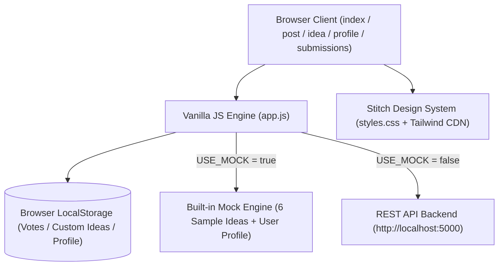

# System Architecture & Technical Specifications

## 1. System Topology & Architecture Diagram

## 2. Request Lifecycle & Data Flow
1. **Explore Board Initialization**: `index.html` loads, calls `app.js:fetchIdeas()`.
   - If `USE_MOCK` is true, loads 6 sample ideas + any user-created ideas from `localStorage:idea_vault_custom_ideas`.
   - If `USE_MOCK` is false, sends `GET http://localhost:5000/ideas`.
2. **Interactive Upvoting & Collaboration**:
   - `handleCardUpvote()` calls `IdeaVault.upvoteIdea(id, btn)`.
   - Checks `localStorage:idea_vault_upvotes`. If already voted, removes vote (toggle) or prevents duplicates.
   - Optimistically updates UI counters and toggles active button state.
   - If `USE_MOCK` is false, invokes `POST /ideas/:id/upvote` or `POST /ideas/:id/interest`.
3. **Duplicate Detection Lifecycle**:
   - In `post.html`, user completes form and submits.
   - System calls `IdeaVault.checkDuplicate(proposalData)`.
   - Computes weighted token similarity against existing repository ideas.
   - If match $\ge 60\%$, halts submission, hides form, renders the **Duplicate Warning Screen** highlighting matched idea title, percentage, excerpt, and link.
   - If user clicks "Proceed with my separate submission", calls `IdeaVault.createIdea()` with `skipDuplicateCheck = true`.
4. **Student Profile & Academic Settings**:
   - `profile.html` loads identity credentials (USN: 4NI21CS089, Dept of CSE, CGPA: 8.92, batch).
   - Form inputs and dynamic skill chips reflect `IdeaVault.getUserProfile()`.
   - Editing and saving writes to `localStorage:idea_vault_user_profile` and synchronizes the header avatar and name across all screens.
   - Includes JSON data export of student submissions and public profile modal preview.
5. **My Submissions Dashboard**:
   - `submissions.html` displays 4 KPI metrics (Total Submissions, Campus Endorsements, Collaborator Inquiries, Teams in Prototyping).
   - Combines baseline ideas with dynamic locally submitted proposals (`idea_vault_custom_ideas`).
   - Supports filter tabs (`All`, `Under Review`, `Approved & Open`, `Team Formed`, `Drafts & Warnings`) and search keywords.
   - Triage sidebar handles peer collaborator requests (Accept / Decline).

## 3. Technology Stack & Zero-Build Strategy
- **Markup**: Semantic HTML5 with Google Material Design tokens.
- **Styling**: Tailwind CSS CDN + custom theme tokens configured in `<script id="tailwind-config">` + `styles.css`.
- **Icons**: Material Symbols Outlined (`Inter` typography).
- **Core Logic**: Vanilla JavaScript ES6+ (`app.js`).
- **Data Persistence**: `window.localStorage` with namespaced keys:
  - `idea_vault_upvotes`
  - `idea_vault_interests`
  - `idea_vault_bookmarks`
  - `idea_vault_custom_ideas`
  - `idea_vault_user_profile`

## 4. API Specification
| Method | Endpoint | Description | Request Body | Response |
| :--- | :--- | :--- | :--- | :--- |
| `GET` | `/ideas` | Retrieve campus ideas registry | None | `Idea[]` |
| `POST` | `/ideas` | Submit new proposal | `{ title, description, department, category, tags, bom }` | `{ success: true, idea: Idea }` |
| `POST` | `/ideas/:id/upvote` | Upvote an existing proposal | None | `{ success: true, upvotes: number }` |
| `POST` | `/ideas/:id/interest` | Register collaboration interest | None | `{ success: true, interests: number }` |
| `POST` | `/check-duplicate` | Pre-submission similarity audit | `{ title, description, category }` | `{ hasDuplicate: boolean, matchPercentage: number, matchedIdea: Idea }` |
