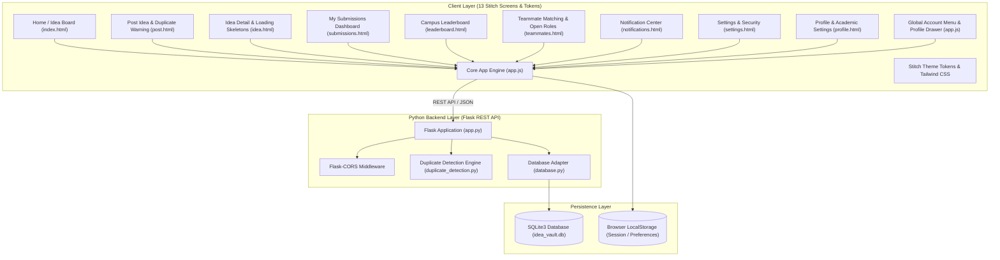
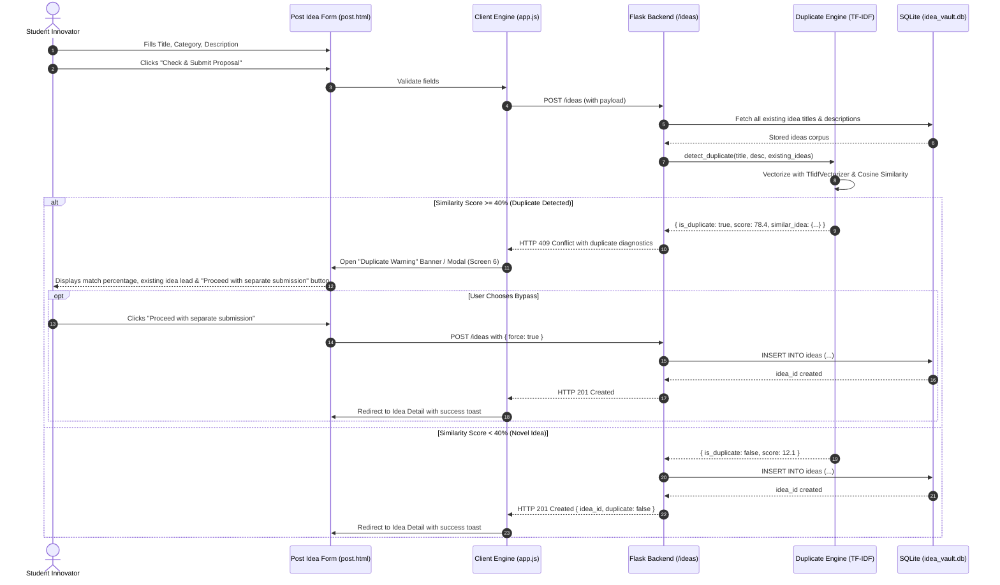
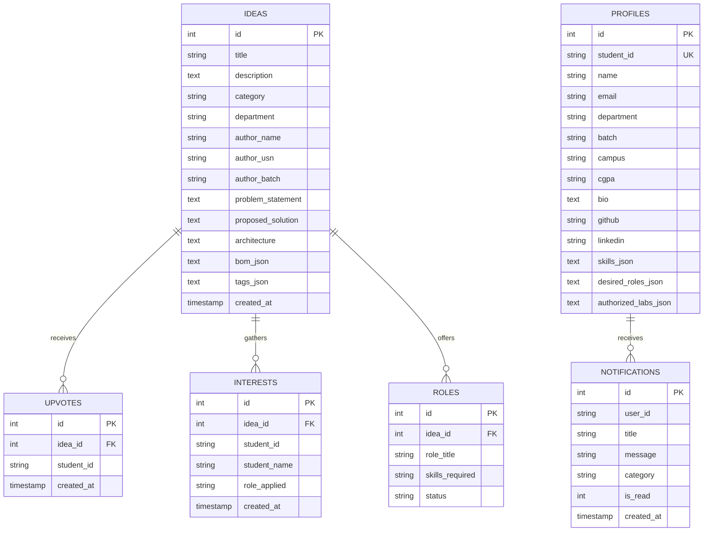

# System Architecture & Technical Specifications — NIE Idea Vault

## 1. System Topology & Architecture Diagram

## 2. Request Lifecycle & Duplicate Check Data Flow

## 3. Database Schema & Data Models

## 4. API Endpoint Matrix
| Method | Endpoint | Description | Request Body | Response Status |
| :--- | :--- | :--- | :--- | :--- |
| `GET` | `/ideas` | List all ideas with upvotes, interests, search & category filters | Query: `q`, `category`, `department`, `sort` | 200 OK |
| `GET` | `/ideas/<id>` | Retrieve complete idea technical profile, BOM & open roles | None | 200 OK / 404 Not Found |
| `POST` | `/ideas` | Submit a new capstone idea (runs duplicate guard, supports `force`) | `{title, description, category, department, force, ...}` | 201 Created / 409 Conflict / 400 Bad Request |
| `POST` | `/ideas/check-duplicate` | Real-time duplicate check without creating idea | `{title, description}` | 200 OK (`{is_duplicate, similarity_score, similar_idea}`) |
| `POST` | `/ideas/<id>/upvote` | Toggle student upvote on idea | `{student_id}` | 200 OK (`{upvotes, is_upvoted}`) |
| `POST` | `/ideas/<id>/interest` | Express interest in joining project team role | `{student_id, student_name, role_applied}` | 200 OK (`{interests, is_interested}`) |
| `GET` | `/leaderboard` | Get campus rankings by upvotes, podium, department stats | None | 200 OK |
| `GET` | `/roles` | List all open project roles across campus | Query: `skill` | 200 OK |
| `GET` | `/notifications` | Campus activity stream and alert logs | Query: `user_id` | 200 OK (`{notifications, unread_count}`) |
| `POST` | `/notifications/<id>/read` | Mark single notification read | None | 200 OK |
| `POST` | `/notifications/read-all` | Mark all notifications read for user | Query: `user_id` | 200 OK |
| `GET` | `/profile` | Get student academic profile details | Query: `student_id` | 200 OK |
| `PUT` | `/profile` | Update student profile details | Profile JSON | 200 OK |

## 5. Stitch Design System Architecture
- **Color Palette Tokens**:
  - `primary`: `#3525cd` / `primary-container`: `#4f46e5`
  - `secondary`: `#006c49` / `secondary-container`: `#6cf8bb`
  - `tertiary`: `#684000` / `tertiary-container`: `#885500`
  - `surface`: `#f8f9ff` / `surface-container`: `#e5eeff` / `surface-container-highest`: `#d3e4fe`
- **Typography**: Inter (Body, Label, Title, Headline).
- **Iconography**: Google Material Symbols Outlined.
