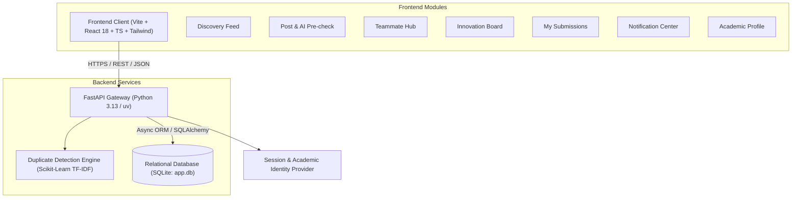
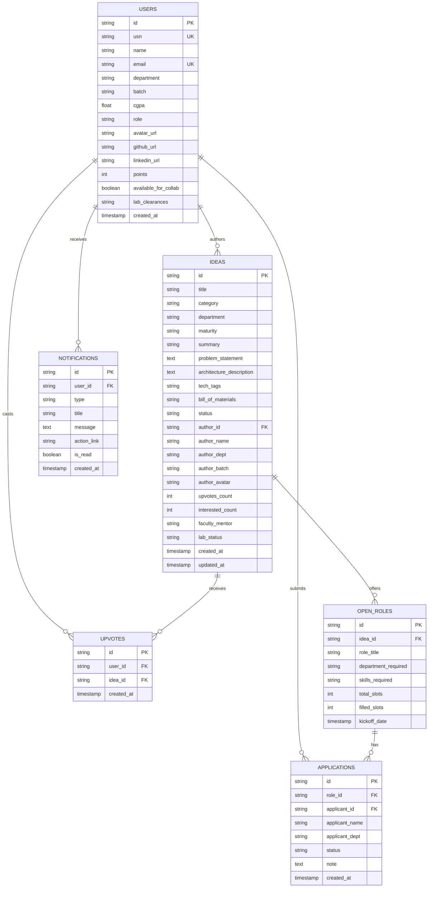

# System Architecture & Technical Specifications — NIE Idea Vault

## 1. System Topology & Architecture Diagram

---

## 2. Request Lifecycle & Data Flow
1. **Client Interaction**: User triggers an action (e.g., submits capstone idea for validation).
2. **CORS & Security Middleware**: Validates origins (`localhost:5173`), sets security headers, and generates request trace IDs.
3. **Payload Validation**: FastAPI intercepts request and validates schema using Pydantic v2 models.
4. **Duplicate Similarity Pipeline**:
   - The proposal text (Title, Category, Problem Statement, Description, Tech Stack) is normalized.
   - Vectorized against the stored corpus of active and archived projects using `TfidfVectorizer(ngram_range=(1, 2), stop_words='english')`.
   - Computes Cosine Similarity matrix.
   - Computes dimensional breakdown: Problem Context, Hardware/Tech Choice, Target Demographic.
   - If similarity score >= threshold (default `0.40`), returns duplicate warning payload with the conflicting project reference.
5. **Database Persistence**: Parameterized SQLAlchemy transaction stores the new idea or updates votes/applications.
6. **Response Serialization**: Filtered JSON payload delivered to frontend with optimistic UI updates.

---

## 3. Database Schema & Data Models (ERD)

---

## 4. API Endpoint Matrix

| Method | Endpoint | Description | Request Body | Response Body |
| :--- | :--- | :--- | :--- | :--- |
| `GET` | `/api/v1/health` | Healthcheck and similarity engine status | None | `HealthResponse` |
| `GET` | `/api/v1/ideas` | List ideas with search, category filter, sorting | Query params (`q`, `category`, `dept`, `sort`) | `List[IdeaSummary]` |
| `GET` | `/api/v1/ideas/{id}` | Get complete idea details, open roles, metrics | None | `IdeaDetail` |
| `POST` | `/api/v1/ideas/check-duplicate` | Run AI duplicate detection against corpus | `IdeaCheckRequest` | `DuplicateCheckResult` |
| `POST` | `/api/v1/ideas` | Create and publish a new capstone idea | `IdeaCreateRequest` | `IdeaDetail` |
| `POST` | `/api/v1/ideas/{id}/upvote` | Toggle upvote for an idea | `UserActionRequest` | `UpvoteResponse` |
| `POST` | `/api/v1/ideas/{id}/interest` | Express interest / request collaboration | `UserActionRequest` | `InterestResponse` |
| `GET` | `/api/v1/teammates/roles` | List all open project vacancies across campus | Query params (`role`, `dept`) | `List[OpenRoleCard]` |
| `POST` | `/api/v1/teammates/apply` | Apply for an open role | `RoleApplyRequest` | `ApplicationResult` |
| `GET` | `/api/v1/leaderboard` | Top students podium, department standings | Query params (`period`) | `LeaderboardData` |
| `GET` | `/api/v1/notifications` | List user notifications and activity feed | Query params (`user_id`, `category`) | `List[NotificationItem]` |
| `POST` | `/api/v1/notifications/{id}/action` | Accept / decline applicant action | `NotificationActionRequest` | `ActionResponse` |
| `GET` | `/api/v1/users/{id}/submissions` | Get student's project dashboard & stats | None | `UserSubmissionsData` |
| `GET` | `/api/v1/users/{id}/profile` | Get student profile & credentials | None | `UserProfileData` |
| `PUT` | `/api/v1/users/{id}/profile` | Update profile settings | `ProfileUpdateRequest` | `UserProfileData` |

---

## 5. Duplicate Detection Algorithm Specifications
- **Corpus Representation**: Active and archived capstones concatenated across `[title, category, department, problem_statement, tech_tags, summary]`.
- **Vectorization**: Scikit-Learn `TfidfVectorizer` with:
  - English stop words removal.
  - Sublinear term frequency scaling (`sublinear_tf=True`).
  - Unigram and bigram extraction (`ngram_range=(1, 2)`).
- **Similarity Computation**: Pairwise Cosine Similarity:
  $$\text{Cosine Similarity} = \frac{\mathbf{A} \cdot \mathbf{B}}{\|\mathbf{A}\|_2 \|\mathbf{B}\|_2}$$
- **Multi-Factor Breakdown**:
  - Overall Similarity: $S_{\text{overall}}$
  - Problem Context Similarity: $S_{\text{context}}$ (similarity computed exclusively on problem statements)
  - Hardware & Tech Choice: $S_{\text{tech}}$ (Jaccard & TF-IDF similarity on tech tags)
  - Target Demographic: $S_{\text{demographic}}$ (department and user scope overlap)
- **Thresholds**:
  - $S < 0.40$: Novel / Unique (Green clearance)
  - $0.40 \le S < 0.75$: Moderate Overlap (Yellow alert: recommend review)
  - $S \ge 0.75$: High Duplicate Risk (Amber/Crimson alert: recommend team joining or mentor review)

---

## 6. Frontend Design Token Architecture (Google Stitch)
- **Primary Accent**: `#4F46E5` / `#3525CD` (Electric Indigo)
- **Secondary Accent**: `#006C49` (Verified Emerald)
- **Tertiary Accent**: `#885500` / `#684000` (Duplicate Amber)
- **Error Accent**: `#BA1A1A` (Destructive Crimson)
- **Surface**: `#F8F9FF`
- **Surface Containers**: Lowest `#FFFFFF`, Low `#EFF4FF`, Standard `#E5EEFF`, High `#DCE9FF`, Highest `#D3E4FE`
- **Typography**: Inter (`font-body-md`, `font-title-md`, `font-headline-lg`, `font-display-lg`)
- **Iconography**: Google Material Symbols Outlined
