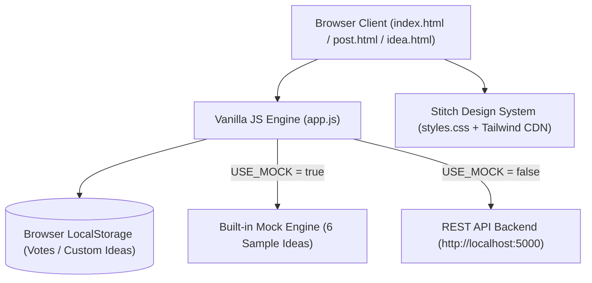
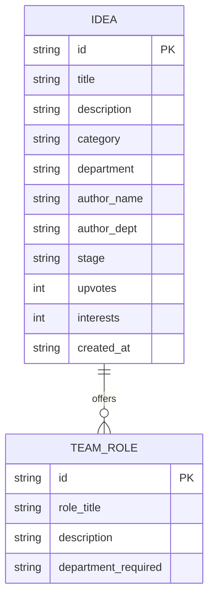

# System Architecture & Technical Specifications

## 1. System Topology & Architecture Diagram

## 2. Request Lifecycle & Data Flow
1. **Explore Board Initialization**: `index.html` loads, calls `app.js:fetchIdeas()`.
   - If `USE_MOCK` is true, loads 6 sample ideas + any user-created ideas from `localStorage`.
   - If `USE_MOCK` is false, dispatches asynchronous `fetch('${API_BASE}/ideas')` with loading skeleton.
2. **Duplicate Detection & Posting**:
   - User completes form on `post.html`.
   - `app.js:checkDuplicate()` executes. In mock mode, token Jaccard similarity is computed across titles and descriptions.
   - If similarity >= 60%, Duplicate Warning banner renders with match score, existing project overview, and link.
   - If user confirms "Proceed with my separate submission", `createIdea()` executes `POST /ideas`.
3. **Optimistic Vote Cycle**:
   - User clicks Upvote or Collab button.
   - `localStorage` checks if user already voted for idea ID.
   - Count increments immediately in DOM, active button state toggles.
   - Background POST to `/ideas/:id/upvote` or `/ideas/:id/interest` updates server/mock record.

## 3. Data Models

## 4. API Endpoint Matrix
| Method | Endpoint | Request Body | Response Body | Description |
| :--- | :--- | :--- | :--- | :--- |
| `GET` | `/ideas` | Query params (`category`, `sort`, `q`) | `Idea[]` | Retrieve filtered idea list |
| `POST` | `/ideas` | `{ title, description, category, department, tags, ... }` | `{ success: true, idea: Idea }` | Publish new idea |
| `POST` | `/ideas/:id/upvote` | None | `{ success: true, upvotes: number }` | Upvote idea |
| `POST` | `/ideas/:id/interest` | None | `{ success: true, interests: number }` | Express collaboration interest |
| `POST` | `/check-duplicate` | `{ title, description, category }` | `{ isDuplicate: bool, similarity: number, matchedIdea: Idea }` | Similarity check |
